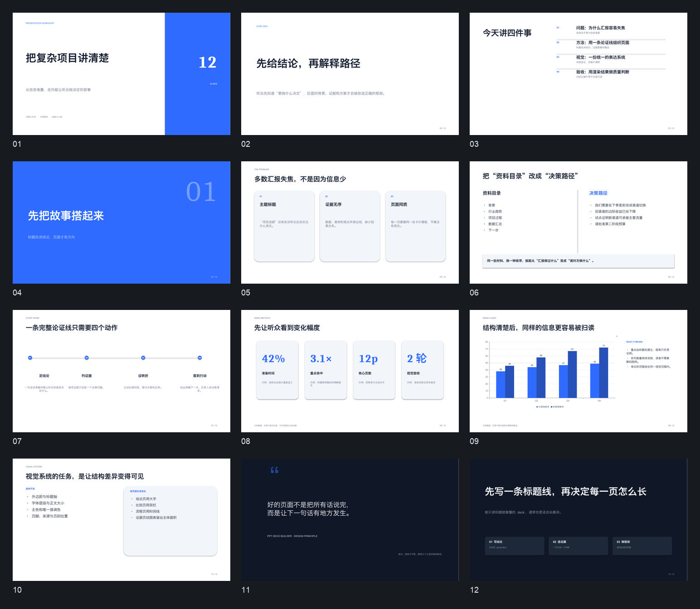
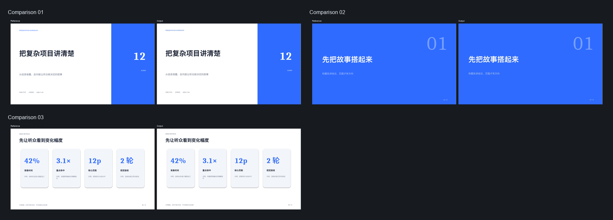

# PPT Deck Builder

一个面向 Codex / Agent 的演示文稿制作 Skill：先把故事和交付方式想清楚，再选择合适的生产线，最终用真实渲染结果验收。

> A route-aware presentation workflow for native PPTX, template-faithful editing, image-first decks, hybrid reconstruction, and HTML/motion delivery.

[](LICENSE)



## 为什么需要它

大多数 AI PPT 工具只解决“生成一些页面”。真实交付还会遇到更多问题：

- 客户需要直接在 PowerPoint 里改字、改图表
- 公司模板不能破坏，只允许替换内容
- 图片型页面很好看，但文字不可编辑
- 已有截图需要还原成可编辑页面
- 演示需要浏览器、演讲者视图或视频转场
- 页面能生成，不代表没有溢出、重影、裁切和信息失真

`PPT Deck Builder` 先判断交付约束，再选择路线，并把“结构可编辑”与“视觉语义保真”分开验收。

## 七条生产路线

| 路线 | 适合场景 | 输出 |
|---|---|---|
| Native PPTX | 常规汇报、路演、教学、答辩 | 原生可编辑 `.pptx` |
| Template-Faithful | 企业模板、品牌母版、客户指定版式 | 保留模板设计的 `.pptx` |
| Image-First | 视觉概念、传播型幻灯片、活动视觉 | 每页一张成品图的 `.pptx` |
| Hybrid | 既要视觉还原，也要关键文字可编辑 | 原生信息层 + 受控视觉资产 |
| HTML Deck | 浏览器放映、演讲者模式、网页动效 | 静态 HTML / Web 演示 |
| Motion / Video | 录屏式演示、转场、自运行播放 | 图片、视频或交互播放器 |
| Fidelity | 蓝图像 1:1 还原、复杂图表和异形结构 | 带参考对照的原生/混合 PPTX |

路线选择与停止条件详见 [references/production-routes.md](references/production-routes.md)。

## 核心能力

### 1. 先锁故事，再选视觉

- audience / outcome / duration / delivery 模式
- SCR、Pyramid、Funnel、Journey、Teach 等叙事骨架
- action title 与 ghost-deck 测试
- 证据、caveat、so-what 和来源追踪

### 2. 多路线生产

- 原生 PPTX：文本、形状、图表、备注和页码
- 模板保真：按 shape / paragraph / run 检查后替换内容
- 图片型 PPT：提示词、成品图、备注、alt text 和合成
- 混合重构：可编辑信息层 + 非文字视觉资产
- HTML / Motion：固定舞台、演讲者模式、转场与视频

### 3. 双层质量检查

不把“文件能生成”当成任务完成。

- 结构审计：页数、画布、越界、占位文字、备注、小字号
- 渲染检查：逐页 PNG、contact sheet、溢出、遮挡、裁切
- 参考对照：side-by-side、50% overlay、差异热图



## 安装

将仓库放到 Codex 的 skills 目录：

```bash
git clone https://github.com/SunHao9661/ppt-deck-builder.git \
  ~/.codex/skills/ppt-deck-builder
```

然后在 Codex 中显式调用：

```text
使用 $ppt-deck-builder，把这份 PDF 做成一份 12 页、面向管理层的可编辑 PPTX。
```

也可以直接描述 PPT 任务，Skill 会根据任务内容自动路由。

## 常用用法

### 原生可编辑 PPTX

```text
使用 $ppt-deck-builder，把这份材料做成一份 15 页可编辑 PPTX。
先用 ghost deck 确认故事线，再生成并逐页渲染验收。
```

### 企业模板保真

```text
使用 $ppt-deck-builder，以我提供的 PPTX 为模板生成新版本。
保留母版、版式和字体，只替换文字、图表数据和必要页面。
```

### 图片型 PPT

```text
使用 $ppt-deck-builder，制作一份 10 页高视觉冲击力的图片型 PPT。
先做一页真实内容样页，确认后再生成全套并合成 PPTX。
```

### 图片 / 截图还原

```text
使用 $ppt-deck-builder，把这些页面截图还原成可编辑 PPTX。
标题、正文、指标和简单图表必须是原生对象，复杂视觉可以保留为图片资产。
```

### HTML / 视频演示

```text
使用 $ppt-deck-builder，制作一份可在浏览器放映的 HTML 演示，
需要演讲者模式、计时器和页面导航。
```

## 工作流

```text
需求与交付约束
      ↓
Deck Plan + Ghost Deck
      ↓
选择生产路线与视觉系统
      ↓
样页确认（图片 / 混合 / 高保真路线）
      ↓
生成页面与原生资产
      ↓
结构审计 + 逐页渲染
      ↓
可选：参考图对照与差异检查
      ↓
交付 PPTX / HTML / 视频 + 源文件
```

## 工具

| 脚本 | 作用 |
|---|---|
| `scripts/validate_deck_plan.py` | 校验故事线、行动标题、证据、来源、路线要求和重复版式 |
| `scripts/build_pptx.py` | 从结构化 JSON 生成可编辑 PPTX，支持 12 类页面 |
| `scripts/inspect_pptx.py` | 展开模板或成品的页面、形状、段落、run、坐标、图表和表格结构 |
| `scripts/audit_pptx.py` | 检查页数、画布、越界、占位文字、备注、字号和空白页 |
| `scripts/render_pptx.py` | 使用 LibreOffice + Poppler 输出逐页 PNG 和 contact sheet |
| `scripts/assemble_image_pptx.py` | 把批准的逐页图片合成为图片型 PPTX，写入备注和 alt text |
| `scripts/compare_renders.py` | 生成参考/成品的并排图、叠图、差异热图和数值报告 |

## 快速验证

```bash
# 校验结构化计划
python3 scripts/validate_deck_plan.py references/example-plan.json --ghost

# 生成示例原生 PPTX
python3 scripts/build_pptx.py references/example-deck.json output.pptx

# 结构审计
python3 scripts/audit_pptx.py output.pptx --ghost --strict

# 逐页渲染 + contact sheet
python3 scripts/render_pptx.py output.pptx work/renders --dpi 144

# 参考图与成品对照
python3 scripts/compare_renders.py approved/ work/renders --out-dir work/compare
```

## 依赖

基础：

- Python 3.10+
- `python-pptx`
- `Pillow`

渲染与对照：

- LibreOffice / `soffice`
- Poppler / `pdftoppm`

图片生成、视频生成、TTS 和转场能力取决于当前 Agent 运行时及用户配置的模型/API。

## 重要边界

- 图片型 PPT 的文字不单独可编辑，交付时必须明确标注。
- 混合重构不等于全部原生对象；复杂照片、Logo、特殊材质或异形图形可能保留为图片/矢量资产。
- 1:1 高保真意味着更多测量、样页确认和视觉差异检查，不会通过“看起来差不多”自动判定通过。
- HTML / 视频不能假装是 PowerPoint 原生文件。
- 字体可用性和度量会随操作系统、Office/WPS/Keynote/LibreOffice 变化，必须检查实际渲染。

## 项目结构

```text
ppt-deck-builder/
├── SKILL.md
├── README.md
├── LICENSE
├── agents/
│   └── openai.yaml
├── docs/
│   ├── preview.png
│   └── qa-comparison.png
├── references/
│   ├── deck-plan.md
│   ├── example-deck.json
│   ├── example-plan.json
│   ├── html-motion.md
│   ├── pptx-production.md
│   ├── production-routes.md
│   ├── qa-and-delivery.md
│   ├── research-basis.md
│   ├── story-system.md
│   └── visual-system.md
└── scripts/
    ├── assemble_image_pptx.py
    ├── audit_pptx.py
    ├── build_pptx.py
    ├── compare_renders.py
    ├── inspect_pptx.py
    ├── render_pptx.py
    └── validate_deck_plan.py
```

## 设计与研究依据

本 Skill 综合了原生 PPTX 工程、模板保真、图片生成、图片还原、HTML 演示和视觉 QA 等不同路线的工作流原则。

参考项目、采纳点和许可证边界见：

- [references/research-basis.md](references/research-basis.md)

仓库不包含上述第三方项目的模板、图片、提示词或源代码。

## License

[MIT](LICENSE) © 2026 SunHao9661
